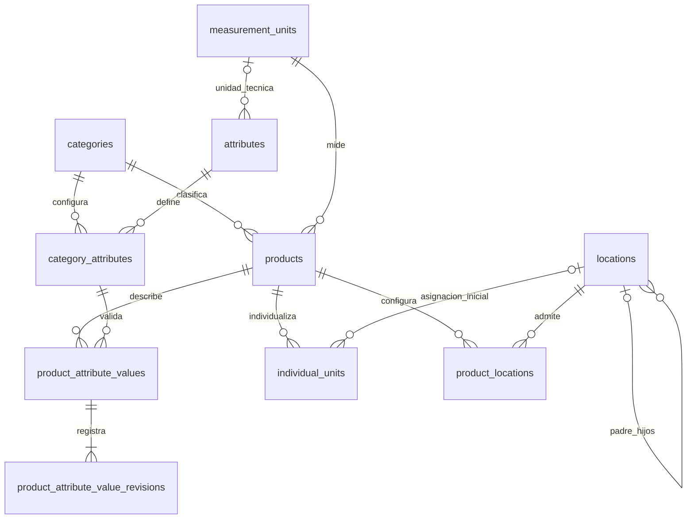

# Diccionario de datos propuesto — Sprint 2

Fecha: 12 de octubre de 2026, America/La_Paz.

**Estado al 19 de octubre de 2026:** categorías, unidades, atributos, `locations`, `products`, valores, revisiones y `product_locations` aplicados a la principal con autorización y respaldo. Hay 25 migraciones aplicadas y 23 tablas en la principal; las dos migraciones de HU-10 están pendientes de autorización para su aplicación allí. `individual_units` está implementada y se valida exclusivamente en testing. Consulta el [plan](sprint-2.md), la [Etapa 4](sprint-2-stage-4.md) y los resultados actuales de la [Etapa 5](sprint-2-stage-5.md).

## Convenciones comunes

Todas las tablas propuestas tienen:

Excepción: `product_attribute_value_revisions` contiene solo autor/fecha de creación y el estado de la instantánea; no tiene autor/fecha de modificación ni un estado predeterminado. Es un historial de solo adición en la aplicación.

| Campo | Tipo | Nulabilidad y regla |
|---|---|---|
| `id` | BIGINT UNSIGNED AUTO_INCREMENT | PK, obligatorio. |
| `is_active` | BOOLEAN | Obligatorio, DEFAULT 1; solo 0 o 1. |
| `created_by` | BIGINT UNSIGNED | Opcional en esquema; FK a `users.id`, eliminación restringida. En operaciones autenticadas se asigna por el servidor. |
| `updated_by` | BIGINT UNSIGNED | Igual tratamiento; identifica al editor real. |
| `created_at` | TIMESTAMP | Marca de tiempo Eloquent. |
| `updated_at` | TIMESTAMP | Marca de tiempo Eloquent. |

InnoDB y `utf8mb4_unicode_ci`, salvo la comparación binaria del símbolo de unidad y de los códigos de tipo de atributo/ubicación. FKs explícitas, con tipos coincidentes e índices; eliminación y modificación de claves referenciadas restringidas. Las desactivaciones conservan registros. Los códigos únicos no se reutilizan al desactivar.

Los autores no se aceptan del formulario. Identificadores y códigos se normalizan en el servidor según la regla de su campo; no se normalizan arbitrariamente símbolos técnicos sensibles a mayúsculas.

## 1. `categories`

Modelo: `Category`.

| Campo propio | Tipo | Regla |
|---|---|---|
| `code` | VARCHAR(50) | Obligatorio, normalizado, único. |
| `name` | VARCHAR(150) | Obligatorio, único según la collation elegida. |
| `description` | TEXT | Opcional. |

Restricciones: `UNIQUE(code)`, `UNIQUE(name)`. Índice de listado `(is_active,name)`.

Relaciones implementadas: `categoryAttributes(): hasMany(CategoryAttribute)` y autoría a `User`. `Product` sigue fuera del alcance; `CatalogReferences` prepara comprobaciones de solo lectura sin crear ese módulo.

Validación: longitud, contenido no vacío, unicidad y permisos. Desactivar se bloquea cuando hay productos activos; productos históricos mantienen su referencia.

## 2. `measurement_units`

Modelo: `MeasurementUnit`.

| Campo propio | Tipo | Regla |
|---|---|---|
| `code` | VARCHAR(30) | Obligatorio, normalizado, único. |
| `name` | VARCHAR(100) | Obligatorio. |
| `symbol` | VARCHAR(20), collation utf8mb4_bin | Obligatorio, único; conservar mayúsculas/minúsculas. |
| `dimension` | VARCHAR(20) | Obligatoria, de catálogo validado. |
| `decimal_places` | TINYINT UNSIGNED | Obligatorio, DEFAULT 0, rango 0–6. |

Dimensiones implementadas para Etapa 1: `count`, `length`, `mass`, `volume`, `time`, `other`, mostradas en español. No se pueblan unidades automáticamente ni se implementa un motor de conversiones. Código normalizado a mayúsculas; símbolo recortado en sus extremos y conservado en su capitalización.

Restricciones: `UNIQUE(code)`, `UNIQUE(symbol)`, `CHECK(decimal_places BETWEEN 0 AND 6)` y validación del conjunto de dimensiones. Índice `(is_active,name)`.

Relaciones implementadas: `attributes(): hasMany(CatalogAttribute)` por su unidad técnica, `products(): hasMany(Product)` y `creator`/`updater` hacia `User`. Se conservan las verificaciones de `CatalogReferences`.

Validación: símbolo y dimensión válidos, precisión compatible con datos existentes. Desactivar se bloquea si la utilizan productos o atributos activos. Con cualquier referencia, incluso inactiva, no se modifican código, símbolo, dimensión o precisión; el nombre puede corregirse. HU-07 verifica atributos reales y HU-08 integra productos reales en las pruebas aisladas.

## 3. `attributes`

Modelo: `CatalogAttribute`, con tabla explícita `attributes`.

| Campo propio | Tipo | Regla |
|---|---|---|
| `code` | VARCHAR(50) | Obligatorio, normalizado, único. |
| `name` | VARCHAR(100) | Obligatorio. |
| `data_type` | VARCHAR(16), utf8mb4_bin | Obligatorio: `text`, `decimal`, `boolean`, `date`, códigos exactos. |
| `measurement_unit_id` | BIGINT UNSIGNED | Opcional; FK a `measurement_units.id`. |
| `help_text` | VARCHAR(255) | Opcional. |

Restricciones: `UNIQUE(code)`, conjunto válido de tipos y unidad técnica solo cuando el tipo sea decimal. Índice `(is_active,name)`; índice de la FK de unidad.

Relaciones: `belongsTo(MeasurementUnit)` y `hasMany(CategoryAttribute)`.

Validación implementada de HU-07: unidad activa al crear/activar; solo atributos decimales admiten unidad. Desde cualquier asociación, incluso inactiva, no se cambia tipo ni unidad, anticipando la conservación de valores históricos. Desactivar exige desactivar antes todas las asociaciones activas, sin cascada. Se puede corregir nombre/ayuda de una definición histórica inactiva conservando su unidad inactiva. No se implementa captura de valores en esta etapa.

## 4. `category_attributes`

Modelo: `CategoryAttribute`, con identidad propia por sus reglas y relaciones.

| Campo propio | Tipo | Regla |
|---|---|---|
| `category_id` | BIGINT UNSIGNED | Obligatorio; FK a `categories.id`. |
| `attribute_id` | BIGINT UNSIGNED | Obligatorio; FK a `attributes.id`. |
| `is_required` | BOOLEAN | Obligatorio, DEFAULT 0. |
| `is_identity` | BOOLEAN | Obligatorio, DEFAULT 0; selecciona características para comparar posibles equivalentes. |
| `display_order` | SMALLINT UNSIGNED | Obligatorio, DEFAULT 0. |
| `min_value` | DECIMAL(18,6) | Opcional, solo para atributo decimal. |
| `max_value` | DECIMAL(18,6) | Opcional, solo para atributo decimal. |

Restricciones: `UNIQUE(category_id,attribute_id)`, `UNIQUE(id,category_id)` para la FK compuesta de valores. CHECK de booleanos y de mínimo ≤ máximo cuando ambos se informen. Índice `(category_id,is_active,display_order)` y FK de atributo.

Relaciones implementadas: `belongsTo(Category)`, `belongsTo(CatalogAttribute)`, `productAttributeValues(): hasMany(ProductAttributeValue)` y autores.

Validación implementada: categoría/atributo/unidad activos para asociar o reactivar, asociación no duplicada aunque esté inactiva, orden entero de 0 a 65535 y límites solo decimales. Punto decimal, hasta 12 enteros y 6 decimales, precisión de la unidad respetada; ceros finales no consumen precisión significativa. Comparación exacta sin FLOAT. Mínimo y máximo permiten cero y negativos.

La categoría se toma de la ruta y no se sustituye; tampoco se sustituye el atributo de una asociación existente. Los guards bloquean cambios de identificación/límites con valores históricos y obligatoriedad con productos activos incompletos, incluida la reactivación de una asociación obligatoria. HU-07 conservó simulaciones de dependencias futuras y HU-08 añadió pruebas con productos y valores reales. Desactivar conserva filas y referencias; no hay DELETE.

## 5. `products`

Modelo: `Product`.

| Campo propio | Tipo | Regla |
|---|---|---|
| `internal_code` | VARCHAR(60) | Obligatorio, normalizado, único en todo el catálogo. |
| `name` | VARCHAR(150) | Obligatorio; no imponer unicidad por nombre. |
| `description` | TEXT | Opcional. |
| `category_id` | BIGINT UNSIGNED | Obligatorio; FK a `categories.id`. |
| `measurement_unit_id` | BIGINT UNSIGNED | Obligatorio; FK a `measurement_units.id`. |
| `control_mode` | VARCHAR(16) | Obligatorio: `quantity` o `individual`. |
| `is_loanable` | BOOLEAN | Obligatorio, DEFAULT 0. |
| `brand` | VARCHAR(100) | Opcional. |
| `manufacturer_reference` | VARCHAR(100) | Opcional. |
| `lock_version` | BIGINT UNSIGNED | DEFAULT 1, positivo; control de edición concurrente del agregado. |

Restricciones: `UNIQUE(internal_code)`, `UNIQUE(id,category_id)`, CHECK de modo y de la implicación `is_loanable → control_mode='individual'`.

Índice de filtros `(category_id,measurement_unit_id,control_mode,is_active)` e índices de FKs. Búsqueda por nombres/referencias mediante consultas parametrizadas; no se propone un motor de búsqueda adicional.

Relaciones implementadas: `belongsTo(Category)`, `belongsTo(MeasurementUnit)`, `hasMany(ProductAttributeValue)`, `hasMany(ProductLocation)`, `belongsToMany(Location)` por `product_locations` y `individualUnits(): hasMany(IndividualUnit)` incorporada en HU-10.

Validación: referencias activas, código único y todos los valores requeridos/tipados de la categoría. Guardar producto y valores de forma atómica. Cambios de categoría, unidad, modo o identidad con valores, unidades o historial necesitan restricciones que conserven trazabilidad; no reinterpretar registros vinculados.

Desactivar conserva asociaciones y unidades, impide nuevos registros operativos y no modifica saldos. No hay columna de stock o cantidad.

Implementado y aplicado a la principal en HU-08 el 18 de octubre de 2026. El código interno es inmutable. Categoría, unidad, modo y prestable no se cambian cuando hay valores, asociaciones o unidades históricas. Los cambios efectivos de producto, valores o asociaciones incrementan `lock_version`; un formulario obsoleto obtiene HTTP 409.

## 6. `product_attribute_values`

Modelo: `ProductAttributeValue`.

| Campo propio | Tipo | Regla |
|---|---|---|
| `product_id` | BIGINT UNSIGNED | Obligatorio. |
| `category_id` | BIGINT UNSIGNED | Obligatorio, completado por el servidor desde el producto. |
| `category_attribute_id` | BIGINT UNSIGNED | Obligatorio. |
| `value_text` | VARCHAR(255) | Opcional según tipo. |
| `value_decimal` | DECIMAL(18,6) | Opcional según tipo; sin conversión a FLOAT. |
| `value_boolean` | BOOLEAN | Opcional según tipo; 0 y 1 son valores válidos. |
| `value_date` | DATE | Opcional según tipo; fecha válida. |

Restricciones: `UNIQUE(product_id,category_attribute_id)`. Exactamente una columna de valor no nula; `value_boolean` solo 0/1 cuando se informe.

FKs compuestas:

```text
(product_id, category_id)
    → products(id, category_id)

(category_attribute_id, category_id)
    → category_attributes(id, category_id)
```

`category_id` es redundancia deliberada para impedir que el producto reciba valores de otra categoría también en la base. Los índices únicos de las tablas referenciadas sostienen esas FKs.

Índices: `(product_id,is_active)`, `(category_attribute_id,value_decimal)` e índices requeridos por las FKs compuestas.

Relaciones: `belongsTo(Product)` y `belongsTo(CategoryAttribute)`.

Validación transaccional del servidor: correspondencia del tipo con la definición, asociación activa, obligatoriedad, rango y precisión. La base comprueba cardinalidad y pertenencia a categoría; las reglas de tipo que dependen de otras tablas no se resuelven mediante un CHECK con subconsultas.

Un atributo opcional no informado no necesita fila. Vaciar un valor existente desactiva su fila sin borrar el último valor. Reactivar/editar reutiliza la asociación única. `0` y `false` no deben confundirse con ausencia.

Valores técnicos negativos pueden ser válidos, por ejemplo una temperatura mínima. La prohibición de existencias negativas no implica prohibir todo valor decimal técnico negativo.

### 6.1. `product_attribute_value_revisions`

Modelo `ProductAttributeValueRevision`, incorporado con aprobación para conservar todas las versiones anteriores. Campos: `id` BIGINT UNSIGNED PK; `product_attribute_value_id` FK RESTRICT al valor; `revision` BIGINT UNSIGNED positivo; `value_text` VARCHAR(255), `value_decimal` DECIMAL(18,6), `value_boolean` BOOLEAN y `value_date` DATE, nullable con exactamente una informada; `is_active` obligatorio; `created_by` FK obligatoria a usuarios; `created_at` TIMESTAMP obligatorio.

UNIQUE `(product_attribute_value_id,revision)`, CHECK de revisión positiva, cardinalidad y booleanos. Sin columnas de modificación ni rutas de edición/borrado. La creación inicial y cada cambio efectivo generan una instantánea en la misma transacción del agregado. Vaciar un opcional conserva el último contenido y registra su estado inactivo. Las protecciones del modelo no sustituyen los privilegios SQL del servidor.

## 7. `locations`

Modelo: `Location`.

| Campo propio | Tipo | Regla |
|---|---|---|
| `code` | VARCHAR(60) | Obligatorio, normalizado, único. |
| `name` | VARCHAR(150) | Obligatorio. |
| `type` | VARCHAR(16), utf8mb4_bin | Obligatorio: `sector`, `shelf`, `cabinet`, mostrados en español. |
| `parent_id` | BIGINT UNSIGNED | Opcional; FK a `locations.id`. |
| `is_storable` | BOOLEAN | Obligatorio, DEFAULT 1. |
| `description` | TEXT | Opcional. |

Restricciones implementadas: `UNIQUE(code)`, CHECK de tipo y booleanos, FK propia y dos FKs de autoría con RESTRICT. Índices `(parent_id,is_active,type)` y `(is_active,name)`. Nombre sin unicidad obligatoria; descripción con límite de formulario de 10.000 caracteres.

Relaciones implementadas: `parent(): belongsTo(Location,'parent_id')`, `children(): hasMany(Location,'parent_id')`, `productLocations(): hasMany(ProductLocation)`, `individualUnits(): hasMany(IndividualUnit)` y autoría a usuarios.

La FK impide padres inexistentes, pero no evita ciclos. `SaveLocation` usa el bloqueo común de `SecurityMutation`; `LocationHierarchy` recorre ancestros con FOR UPDATE después de adquirirlo, rechaza autorreferencia/descendientes y mantiene un conjunto de visitados. Incluye nodos inactivos y no reutiliza un snapshot anterior a la espera. No se usan bloqueos nombrados ni CTE recursivas.

No se plantea un CHECK que compare el ID autoincremental para resolver ciclos. Tampoco se impone una combinación rígida de tipos padre/hijo que no haya sido aprobada.

Crear, cambiar padre o reactivar exige cadena de ancestros activos. Una ubicación inactiva puede corregir metadatos conservando su padre histórico inactivo; ese vínculo no se elimina al desactivar.

Desactivar se bloquea ante hijos activos y asociaciones activas de productos. `LocationReferences` también bloquea cambios de padre/tipo con referencias históricas del subárbol y deshabilitar almacenamiento con referencias propias. HU-08 verifica asociaciones reales de productos y selección de destinos activos/almacenables. HU-10 integra unidades reales, incluso inactivas, para proteger ubicaciones y subárboles.

Se conservan IDs y relaciones existentes. El árbol/ruta representa la estructura actual, sin snapshots históricos completos ni movimientos. La edición de estructura sin referencias es configuración del catálogo; con referencias futuras se bloquean los cambios indicados. No existen rutas DELETE.

## 8. `individual_units`

Implementada en HU-10, Etapa 5, el 19 de octubre de 2026. Migraciones principales pendientes. La especificación operativa siguiente y la [Etapa 5](sprint-2-stage-5.md) documentan las decisiones aprobadas.

Modelo: `IndividualUnit`.

| Campo propio | Tipo | Regla |
|---|---|---|
| `identifier` | VARCHAR(64) | Obligatorio, normalizado, único global, incluso entre inactivos. |
| `product_id` | BIGINT UNSIGNED | Obligatorio; FK a `products.id`. |
| `serial_number` | VARCHAR(100) | Opcional. |
| `location_id` | BIGINT UNSIGNED | Opcional; ubicación de asignación inicial. |
| `notes` | TEXT | Opcional. |

Campo adicional aprobado: `lock_version BIGINT UNSIGNED NOT NULL DEFAULT 1`, con CHECK positivo y comprobación de versión en edición y cambio de estado. La serie usa `utf8mb4_bin`, conserva mayúsculas/minúsculas y convierte vacío en NULL, sin perder la serie `0`. El identificador se recorta y convierte a mayúsculas. Los campos comunes de estado, autores y fechas se conservan.

Identificador, producto y ubicación inicial son inmutables después del alta, incluso si la ubicación es NULL. Se permite completar una serie vacía; una serie informada no se sustituye ni borra en este CRUD. Las observaciones son editables. La reactivación exige producto individual activo y ubicación/asociación válidas cuando se informa ubicación. No hay rutas DELETE ni incremento de existencias.

FK compuesta implementada en la migración nueva, utilizando `product_locations_pair_unique` ya existente; sin alterar la tabla padre. Índice hijo `(product_id,location_id)`, además de los dos índices de estado. FKs de producto, ubicación y autores con RESTRICT; CHECK de estado, versión y campos de identidad no vacíos. Los permisos de HU-10 se inicializan mediante otra migración nueva conservando revocaciones previas.

Restricciones: `UNIQUE(identifier)`, `UNIQUE(product_id,serial_number)` cuando exista serie, FKs explícitas. Índices `(product_id,is_active)` y `(location_id,is_active)`.

HU-10 implementa esta FK compuesta contra la asociación aprobada:

```text
(product_id, location_id)
    → product_locations(product_id, location_id)
```

Relaciones: `belongsTo(Product)` y `belongsTo(Location)`.

Validación: producto activo de control individual; ubicación activa, almacenable y con asociación activa al producto. La FK no comprueba el modo de control ni el estado de las referencias: el servidor también debe hacerlo.

Desactivar conserva identidad, producto y vínculos. No reutilizar identificadores. Cambiar ubicación después de existir historial requiere el flujo autorizado posterior; no implementar traslados desde el CRUD de catálogo. Registrar una unidad no crea un movimiento ni aumenta saldos.

## 9. `product_locations` — Asociación aprobada e implementada en HU-08

Modelo: `ProductLocation`; relación muchos a muchos explícita.

| Campo propio | Tipo | Regla |
|---|---|---|
| `product_id` | BIGINT UNSIGNED | Obligatorio; FK a `products.id`. |
| `location_id` | BIGINT UNSIGNED | Obligatorio; FK a `locations.id`. |

Restricciones: `UNIQUE(product_id,location_id)`. Índice `(location_id,is_active)` y FKs. Campos comunes de identidad, estado, autores y timestamps.

Relaciones: `belongsTo(Product)` y `belongsTo(Location)`; Product expone `belongsToMany(Location)` con estado y timestamps, y ambos extremos exponen `hasMany(ProductLocation)`.

Validación: referencias activas, ubicación almacenable, sin asociación duplicada. Desactivar se bloquea si una unidad permanece asignada allí. No borrar asociaciones con historial.

Esta tabla representa ubicaciones configuradas para el producto y no tiene cantidades. Aprobada, implementada y aplicada a la principal en HU-08 el 18 de octubre de 2026. Se permiten cero o varias ubicaciones. Las parejas no se sustituyen; una pareja inactiva se reactiva. Se bloquea la desactivación de ubicaciones con asociaciones activas. HU-10 incorpora la FK compuesta y pruebas de integración real de PLC-03: una asociación con unidades asignadas, incluso inactivas, no se desactiva.

## Diagrama de relaciones propuesto



Las referencias de autoría a `users` se omiten del diagrama para legibilidad, pero son explícitas en el esquema. No hay segunda tabla de almacenes, saldos ni movimientos.

## Compatibilidad y límites

- InnoDB, claves foráneas explícitas y DECIMAL disponibles en MariaDB 10.4.32.
- Usar la collation existente y evitar collations específicas de MySQL 8.
- CHECK mediante SQL explícito dentro de nuevas migraciones; verificar su aplicación en pruebas sobre MariaDB.
- Usar nombres de restricciones únicos en el esquema y dentro de los límites de longitud del servidor.
- No depender de consultas sobre JSON ni de paquetes adicionales para el esquema.
- Categorías, unidades, atributos, ubicaciones, productos, valores, revisiones y asociaciones tienen índices, FKs y CHECK comprobados sobre MariaDB 10.4.32 en la base exclusiva. Las cuatro tablas de HU-08 se aplicaron a la principal el 18 de octubre de 2026; sus estructuras coinciden con las probadas en testing. Unidades individualizadas implementadas en HU-10, con aplicación principal pendiente.
- Guardar códigos y valores técnicos de forma consistente, sin FLOAT ni certificación automática de equivalencias.
- Historial y saldos posteriores deberán respetar las identidades, FKs y desactivaciones de este catálogo.

Referencias oficiales: [restricciones MariaDB](https://mariadb.com/docs/server/reference/sql-statements/data-definition/constraint), [DECIMAL](https://mariadb.com/docs/server/reference/data-types/numeric-data-types/decimal), [GET_LOCK](https://mariadb.com/docs/server/reference/sql-functions/secondary-functions/miscellaneous-functions/get_lock), [relaciones Eloquent](https://laravel.com/docs/13.x/eloquent-relationships).

## Pruebas asociadas

Los casos y la autorización se detallan en [la matriz de pruebas](sprint-2-test-matrix.md). Los informes de [Etapa 1](sprint-2-stage-1.md), [Etapa 2](sprint-2-stage-2.md), [Etapa 3](sprint-2-stage-3.md) y [Etapa 4](sprint-2-stage-4.md) distinguen ejecución real de simulaciones. HU-08 integra productos/valores/asociaciones reales; La Etapa 5 integra unidades reales; su aplicación principal y la aceptación visual permanecen pendientes.
