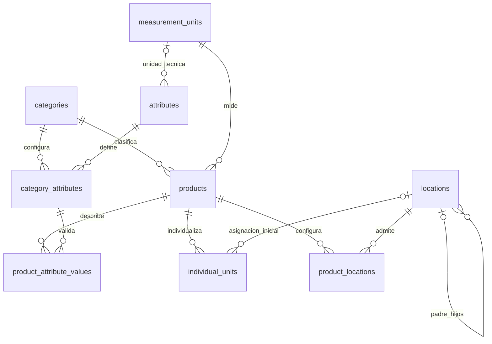

# Diccionario de datos propuesto — Sprint 2

Fecha: 12 de octubre de 2026, America/La_Paz.

**Estado: `categories` y `measurement_units` aplicadas en la base principal con autorización el 13 de octubre de 2026. `attributes` y `category_attributes` implementadas y probadas en la rama de HU-07, con migraciones aplicadas únicamente a testing.** Las demás tablas son diseño pendiente. `product_locations` requiere aprobación explícita. Consulta el [plan](sprint-2.md), la [Etapa 1](sprint-2-stage-1.md) y las [reglas y evidencia de Etapa 2](sprint-2-stage-2.md).

## Convenciones comunes

Todas las tablas propuestas tienen:

| Campo | Tipo | Nulabilidad y regla |
|---|---|---|
| `id` | BIGINT UNSIGNED AUTO_INCREMENT | PK, obligatorio. |
| `is_active` | BOOLEAN | Obligatorio, DEFAULT 1; solo 0 o 1. |
| `created_by` | BIGINT UNSIGNED | Opcional en esquema; FK a `users.id`, eliminación restringida. En operaciones autenticadas se asigna por el servidor. |
| `updated_by` | BIGINT UNSIGNED | Igual tratamiento; identifica al editor real. |
| `created_at` | TIMESTAMP | Marca de tiempo Eloquent. |
| `updated_at` | TIMESTAMP | Marca de tiempo Eloquent. |

InnoDB y `utf8mb4_unicode_ci`, salvo la comparación binaria del símbolo de unidad y del código de tipo de atributo. FKs explícitas, con tipos coincidentes e índices; eliminación y modificación de claves referenciadas restringidas. Las desactivaciones conservan registros. Los códigos únicos no se reutilizan al desactivar.

Los autores no se aceptan del formulario. Identificadores y códigos se normalizan en el servidor según la regla de su campo; no se normalizan arbitrariamente símbolos técnicos sensibles a mayúsculas.

## 1. `categories`

Modelo: `Category`.

| Campo propio | Tipo | Regla |
|---|---|---|
| `code` | VARCHAR(50) | Obligatorio, normalizado, único. |
| `name` | VARCHAR(150) | Obligatorio, único según la collation elegida. |
| `description` | TEXT | Opcional. |

Restricciones: `UNIQUE(code)`, `UNIQUE(name)`. Índice de listado `(is_active,name)`.

Relaciones implementadas: `categoryAttributes(): hasMany(CategoryAttribute)` y autoría a `User`. `Product` sigue fuera del alcance; `CatalogReferences` prepara comprobaciones de solo lectura sin crear ese módulo.

Validación: longitud, contenido no vacío, unicidad y permisos. Desactivar se bloquea cuando hay productos activos; productos históricos mantienen su referencia.

## 2. `measurement_units`

Modelo: `MeasurementUnit`.

| Campo propio | Tipo | Regla |
|---|---|---|
| `code` | VARCHAR(30) | Obligatorio, normalizado, único. |
| `name` | VARCHAR(100) | Obligatorio. |
| `symbol` | VARCHAR(20), collation utf8mb4_bin | Obligatorio, único; conservar mayúsculas/minúsculas. |
| `dimension` | VARCHAR(20) | Obligatoria, de catálogo validado. |
| `decimal_places` | TINYINT UNSIGNED | Obligatorio, DEFAULT 0, rango 0–6. |

Dimensiones implementadas para Etapa 1: `count`, `length`, `mass`, `volume`, `time`, `other`, mostradas en español. No se pueblan unidades automáticamente ni se implementa un motor de conversiones. Código normalizado a mayúsculas; símbolo recortado en sus extremos y conservado en su capitalización.

Restricciones: `UNIQUE(code)`, `UNIQUE(symbol)`, `CHECK(decimal_places BETWEEN 0 AND 6)` y validación del conjunto de dimensiones. Índice `(is_active,name)`.

Relaciones implementadas: `attributes(): hasMany(CatalogAttribute)` por su unidad técnica y `creator`/`updater` hacia `User`. La relación a `Product` sigue pendiente; se conservan las verificaciones de `CatalogReferences`.

Validación: símbolo y dimensión válidos, precisión compatible con datos existentes. Desactivar se bloquea si la utilizan productos o atributos activos. Con cualquier referencia, incluso inactiva, no se modifican código, símbolo, dimensión o precisión; el nombre puede corregirse. En HU-07 se verifica con atributos reales; la integración con productos sigue pendiente.

## 3. `attributes`

Modelo: `CatalogAttribute`, con tabla explícita `attributes`.

| Campo propio | Tipo | Regla |
|---|---|---|
| `code` | VARCHAR(50) | Obligatorio, normalizado, único. |
| `name` | VARCHAR(100) | Obligatorio. |
| `data_type` | VARCHAR(16), utf8mb4_bin | Obligatorio: `text`, `decimal`, `boolean`, `date`, códigos exactos. |
| `measurement_unit_id` | BIGINT UNSIGNED | Opcional; FK a `measurement_units.id`. |
| `help_text` | VARCHAR(255) | Opcional. |

Restricciones: `UNIQUE(code)`, conjunto válido de tipos y unidad técnica solo cuando el tipo sea decimal. Índice `(is_active,name)`; índice de la FK de unidad.

Relaciones: `belongsTo(MeasurementUnit)` y `hasMany(CategoryAttribute)`.

Validación implementada de HU-07: unidad activa al crear/activar; solo atributos decimales admiten unidad. Desde cualquier asociación, incluso inactiva, no se cambia tipo ni unidad, anticipando la conservación de valores históricos. Desactivar exige desactivar antes todas las asociaciones activas, sin cascada. Se puede corregir nombre/ayuda de una definición histórica inactiva conservando su unidad inactiva. No se implementa captura de valores en esta etapa.

## 4. `category_attributes`

Modelo: `CategoryAttribute`, con identidad propia por sus reglas y relaciones.

| Campo propio | Tipo | Regla |
|---|---|---|
| `category_id` | BIGINT UNSIGNED | Obligatorio; FK a `categories.id`. |
| `attribute_id` | BIGINT UNSIGNED | Obligatorio; FK a `attributes.id`. |
| `is_required` | BOOLEAN | Obligatorio, DEFAULT 0. |
| `is_identity` | BOOLEAN | Obligatorio, DEFAULT 0; selecciona características para comparar posibles equivalentes. |
| `display_order` | SMALLINT UNSIGNED | Obligatorio, DEFAULT 0. |
| `min_value` | DECIMAL(18,6) | Opcional, solo para atributo decimal. |
| `max_value` | DECIMAL(18,6) | Opcional, solo para atributo decimal. |

Restricciones: `UNIQUE(category_id,attribute_id)`, `UNIQUE(id,category_id)` para la FK compuesta de valores. CHECK de booleanos y de mínimo ≤ máximo cuando ambos se informen. Índice `(category_id,is_active,display_order)` y FK de atributo.

Relaciones implementadas: `belongsTo(Category)`, `belongsTo(CatalogAttribute)` y autores. La relación a `ProductAttributeValue` sigue pendiente de HU-08.

Validación implementada: categoría/atributo/unidad activos para asociar o reactivar, asociación no duplicada aunque esté inactiva, orden entero de 0 a 65535 y límites solo decimales. Punto decimal, hasta 12 enteros y 6 decimales, precisión de la unidad respetada; ceros finales no consumen precisión significativa. Comparación exacta sin FLOAT. Mínimo y máximo permiten cero y negativos.

La categoría se toma de la ruta y no se sustituye; tampoco se sustituye el atributo de una asociación existente. Los guards futuros bloquean cambios de identificación/límites con valores históricos y obligatoriedad con productos activos incompletos. Se prueban mediante simulaciones en HU-07; su integración real corresponde a HU-08. Desactivar conserva filas y referencias; no hay DELETE.

## 5. `products`

Modelo: `Product`.

| Campo propio | Tipo | Regla |
|---|---|---|
| `internal_code` | VARCHAR(60) | Obligatorio, normalizado, único en todo el catálogo. |
| `name` | VARCHAR(150) | Obligatorio; no imponer unicidad por nombre. |
| `description` | TEXT | Opcional. |
| `category_id` | BIGINT UNSIGNED | Obligatorio; FK a `categories.id`. |
| `measurement_unit_id` | BIGINT UNSIGNED | Obligatorio; FK a `measurement_units.id`. |
| `control_mode` | VARCHAR(16) | Obligatorio: `quantity` o `individual`. |
| `is_loanable` | BOOLEAN | Obligatorio, DEFAULT 0. |
| `brand` | VARCHAR(100) | Opcional. |
| `manufacturer_reference` | VARCHAR(100) | Opcional. |

Restricciones: `UNIQUE(internal_code)`, `UNIQUE(id,category_id)`, CHECK de modo y de la implicación `is_loanable → control_mode='individual'`.

Índice de filtros `(category_id,measurement_unit_id,control_mode,is_active)` e índices de FKs. Búsqueda por nombres/referencias mediante consultas parametrizadas; no se propone un motor de búsqueda adicional.

Relaciones: `belongsTo(Category)`, `belongsTo(MeasurementUnit)`, `hasMany(ProductAttributeValue)`, `hasMany(IndividualUnit)` y `belongsToMany(Location)` por `product_locations` si se aprueba.

Validación: referencias activas, código único y todos los valores requeridos/tipados de la categoría. Guardar producto y valores de forma atómica. Cambios de categoría, unidad, modo o identidad con valores, unidades o historial necesitan restricciones que conserven trazabilidad; no reinterpretar registros vinculados.

Desactivar conserva asociaciones y unidades, impide nuevos registros operativos y no modifica saldos. No hay columna de stock o cantidad.

## 6. `product_attribute_values`

Modelo: `ProductAttributeValue`.

| Campo propio | Tipo | Regla |
|---|---|---|
| `product_id` | BIGINT UNSIGNED | Obligatorio. |
| `category_id` | BIGINT UNSIGNED | Obligatorio, completado por el servidor desde el producto. |
| `category_attribute_id` | BIGINT UNSIGNED | Obligatorio. |
| `value_text` | VARCHAR(255) | Opcional según tipo. |
| `value_decimal` | DECIMAL(18,6) | Opcional según tipo; sin conversión a FLOAT. |
| `value_boolean` | BOOLEAN | Opcional según tipo; 0 y 1 son valores válidos. |
| `value_date` | DATE | Opcional según tipo; fecha válida. |

Restricciones: `UNIQUE(product_id,category_attribute_id)`. Exactamente una columna de valor no nula; `value_boolean` solo 0/1 cuando se informe.

FKs compuestas:

```text
(product_id, category_id)
    → products(id, category_id)

(category_attribute_id, category_id)
    → category_attributes(id, category_id)
```

`category_id` es redundancia deliberada para impedir que el producto reciba valores de otra categoría también en la base. Los índices únicos de las tablas referenciadas sostienen esas FKs.

Índices: `(product_id,is_active)`, `(category_attribute_id,value_decimal)` e índices requeridos por las FKs compuestas.

Relaciones: `belongsTo(Product)` y `belongsTo(CategoryAttribute)`.

Validación transaccional del servidor: correspondencia del tipo con la definición, asociación activa, obligatoriedad, rango y precisión. La base comprueba cardinalidad y pertenencia a categoría; las reglas de tipo que dependen de otras tablas no se resuelven mediante un CHECK con subconsultas.

Un atributo opcional no informado no necesita fila. Vaciar un valor existente desactiva su fila sin borrar el último valor. Reactivar/editar reutiliza la asociación única. `0` y `false` no deben confundirse con ausencia.

Valores técnicos negativos pueden ser válidos, por ejemplo una temperatura mínima. La prohibición de existencias negativas no implica prohibir todo valor decimal técnico negativo.

## 7. `locations`

Modelo: `Location`.

| Campo propio | Tipo | Regla |
|---|---|---|
| `code` | VARCHAR(60) | Obligatorio, normalizado, único. |
| `name` | VARCHAR(150) | Obligatorio. |
| `type` | VARCHAR(16) | Obligatorio: `sector`, `shelf`, `cabinet`, mostrados en español. |
| `parent_id` | BIGINT UNSIGNED | Opcional; FK a `locations.id`. |
| `is_storable` | BOOLEAN | Obligatorio, DEFAULT 1. |
| `description` | TEXT | Opcional. |

Restricciones: `UNIQUE(code)`, CHECK de tipo y booleanos, FK propia. Índice `(parent_id,is_active,type)`.

Relaciones: `belongsTo(Location,'parent_id')`, `hasMany(Location,'parent_id')`, `hasMany(IndividualUnit)` y `belongsToMany(Product)` si se aprueba la asociación.

La FK impide padres inexistentes, pero no evita ciclos. La acción de jerarquía validará padre activo, autorreferencia y descendientes, serializando las modificaciones del árbol mediante un bloqueo común y una transacción. Un bloqueo nombrado debe incluir el nombre de la base y liberarse explícitamente; no se libera solo por COMMIT.

No se plantea un CHECK que compare el ID autoincremental para resolver ciclos. Tampoco se impone una combinación rígida de tipos padre/hijo que no haya sido aprobada.

Desactivar se bloquea ante hijos activos o unidades asignadas. Conservar rutas y asociaciones históricas. Una ubicación no almacenable no puede seleccionarse como destino inicial de unidades.

## 8. `individual_units`

Modelo: `IndividualUnit`.

| Campo propio | Tipo | Regla |
|---|---|---|
| `identifier` | VARCHAR(64) | Obligatorio, normalizado, único global, incluso entre inactivos. |
| `product_id` | BIGINT UNSIGNED | Obligatorio; FK a `products.id`. |
| `serial_number` | VARCHAR(100) | Opcional. |
| `location_id` | BIGINT UNSIGNED | Opcional; ubicación de asignación inicial. |
| `notes` | TEXT | Opcional. |

Restricciones: `UNIQUE(identifier)`, `UNIQUE(product_id,serial_number)` cuando exista serie, FKs explícitas. Índices `(product_id,is_active)` y `(location_id,is_active)`.

Si se aprueba la asociación, añadir FK compuesta:

```text
(product_id, location_id)
    → product_locations(product_id, location_id)
```

Relaciones: `belongsTo(Product)` y `belongsTo(Location)`.

Validación: producto activo de control individual; ubicación activa, almacenable y con asociación activa al producto. La FK no comprueba el modo de control ni el estado de las referencias: el servidor también debe hacerlo.

Desactivar conserva identidad, producto y vínculos. No reutilizar identificadores. Cambiar ubicación después de existir historial requiere el flujo autorizado posterior; no implementar traslados desde el CRUD de catálogo. Registrar una unidad no crea un movimiento ni aumenta saldos.

## 9. `product_locations` — Asociación pendiente de aprobación

Modelo: `ProductLocation`; relación muchos a muchos explícita.

| Campo propio | Tipo | Regla |
|---|---|---|
| `product_id` | BIGINT UNSIGNED | Obligatorio; FK a `products.id`. |
| `location_id` | BIGINT UNSIGNED | Obligatorio; FK a `locations.id`. |

Restricciones: `UNIQUE(product_id,location_id)`. Índice `(location_id,is_active)` y FKs. Campos comunes de identidad, estado, autores y timestamps.

Relaciones: `belongsTo(Product)` y `belongsTo(Location)`; los modelos principales exponen `belongsToMany` con estado y timestamps de la asociación.

Validación: referencias activas, ubicación almacenable, sin asociación duplicada. Desactivar se bloquea si una unidad permanece asignada allí. No borrar asociaciones con historial.

Esta tabla representa ubicaciones configuradas para el producto y no tiene cantidades. Es necesaria para representar varios destinos de un producto por cantidad dentro del alcance del Sprint 2. Si no se aprueba, esa relación de catálogo debe posponerse explícitamente.

## Diagrama de relaciones propuesto



Las referencias de autoría a `users` se omiten del diagrama para legibilidad, pero son explícitas en el esquema. No hay segunda tabla de almacenes, saldos ni movimientos.

## Compatibilidad y límites

- InnoDB, claves foráneas explícitas y DECIMAL disponibles en MariaDB 10.4.32.
- Usar la collation existente y evitar collations específicas de MySQL 8.
- CHECK mediante SQL explícito dentro de nuevas migraciones; verificar su aplicación en pruebas sobre MariaDB.
- Usar nombres de restricciones únicos en el esquema y dentro de los límites de longitud del servidor.
- No depender de consultas sobre JSON ni de paquetes adicionales para el esquema.
- Categorías, unidades, atributos y asociaciones tienen índices, FKs y CHECK comprobados sobre MariaDB 10.4.32 en la base exclusiva. La Etapa 2 registra 185 pruebas y 1.286 verificaciones en la suite completa; las tablas de HU-08 en adelante permanecen sin implementación.
- Guardar códigos y valores técnicos de forma consistente, sin FLOAT ni certificación automática de equivalencias.
- Historial y saldos posteriores deberán respetar las identidades, FKs y desactivaciones de este catálogo.

Referencias oficiales: [restricciones MariaDB](https://mariadb.com/docs/server/reference/sql-statements/data-definition/constraint), [DECIMAL](https://mariadb.com/docs/server/reference/data-types/numeric-data-types/decimal), [GET_LOCK](https://mariadb.com/docs/server/reference/sql-functions/secondary-functions/miscellaneous-functions/get_lock), [relaciones Eloquent](https://laravel.com/docs/13.x/eloquent-relationships).

## Pruebas asociadas

Los casos y la autorización se detallan en [la matriz de pruebas](sprint-2-test-matrix.md). Los informes de [Etapa 1](sprint-2-stage-1.md) y [Etapa 2](sprint-2-stage-2.md) distinguen ejecución real de simulaciones. HU-08 a HU-10, integración con productos/valores y aceptación visual permanecen previstos.
