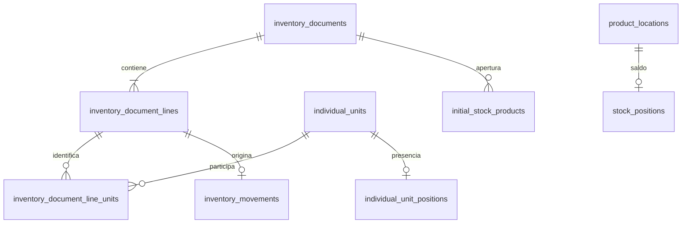

# Diccionario de datos — Sprint 3

Todas las tablas nuevas utilizan InnoDB, IDs compatibles con los existentes y claves foráneas restrictivas. Cantidades `DECIMAL(18,6)`. No se cambian migraciones ya ejecutadas.

| Tabla | Clave y campos principales | Relaciones y restricciones |
|---|---|---|
| inventory_documents | id, uuid único, kind, status, document_date, cutoff_date, counterparty_id/name, external_reference, notes, source, source_sha256, lock_version, autores/fechas de confirmación y cancelación | kind receipt/issue/opening; status draft/confirmed/cancelled; usuarios restrictivos |
| inventory_document_lines | id, document_id, line_number, product_id, location_id, quantity, measurement_unit_id, unit_symbol, decimal_places, control_mode | UNIQUE documento/número y documento/producto/ubicación; FK producto–ubicación; snapshots de unidad/control |
| inventory_document_line_units | document_line_id, document_id, product_id, individual_unit_id | PK línea/unidad; UNIQUE documento/unidad; FK compuestas para pertenencia a línea y producto |
| stock_positions | id, product_id, location_id, quantity, lock_version, fechas | UNIQUE producto/ubicación, FK a asociación histórica; CHECK quantity >= 0 |
| inventory_movements | id, document_line_id, product_id, location_id, direction, quantity, created_by, posted_at | UNIQUE línea; FK compuestas línea/producto/ubicación y saldo; CHECK cantidad positiva |
| individual_unit_positions | individual_unit_id PK, product_id, is_present, location_id, last_document_line_id, lock_version, fechas | FK unidad/producto, producto/ubicación y última línea/unidad; presencia exige ubicación; ausencia exige NULL |
| initial_stock_products | product_id PK, inventory_document_id | Reserva permanente de apertura por producto |

Se añade mediante migración nueva un índice UNIQUE `(id, product_id)` a `individual_units` para la FK compuesta. No se cambia el significado de sus campos. Los índices compuestos de líneas protegen la pertenencia del detalle y el movimiento sin depender solo de formularios.

