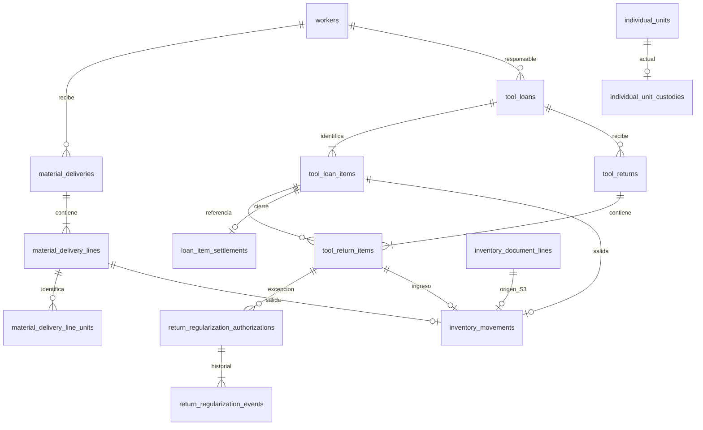

# Diccionario de datos — Sprint 4

Estado: implementación publicada y desplegada con autorización el 20 de octubre de 2026, lote 14. Principal: 42 tablas y 35 migraciones sin pendientes. Véase [despliegue](sprint-4-deployment.md). No sustituye el diccionario histórico del Sprint 3.

## Entidades nuevas

| Tabla | Claves y campos | Integridad |
|---|---|---|
| material_deliveries | id, uuid, worker_id, document_date, status, worker_snapshot, notes, lock_version, autores y fechas | UUID UNIQUE; trabajador/usuarios RESTRICT; estados draft/confirmed/cancelled; metadatos de confirmación y cancelación CHECK |
| material_delivery_lines | id, delivery_id, line_number, product_id, location_id, quantity, measurement_unit_id, unit_symbol, decimal_places, control_mode | UNIQUE entrega/número y entrega/producto/ubicación; DECIMAL(18,6) positivo y precisión; FK compuesta a product_locations |
| material_delivery_line_units | delivery_line_id, delivery_id, product_id, individual_unit_id | PK línea/identidad; UNIQUE entrega/identidad; FK compuestas de pertenencia a línea y producto |
| tool_loans | campos comunes de cabecera, due_date opcional | UNIQUE id/trabajador para pertenencia de devolución; vencimiento validado en servidor |
| tool_loan_items | id, loan_id, individual_unit_id, product_id, location_id, measurement_unit_id, unit_symbol | UNIQUE préstamo/identidad; FK identidad/producto y asociación; una herramienta por ítem |
| tool_returns | campos comunes, loan_id | FK compuesta préstamo/trabajador; una devolución corresponde a un préstamo |
| tool_return_items | id, return_id, loan_id, loan_item_id, individual_unit_id, product_id, location_id | UNIQUE devolución/ítem prestado; FK compuesta a cabecera y pertenencia exacta al préstamo; destino existente |
| individual_unit_custodies | individual_unit_id PK, product_id, current_loan_item_id nullable UNIQUE, lock_version, fechas | FK a identidad/producto, ítem/identidad/producto y movimiento de préstamo; toma condicional de custodia |
| loan_item_settlements | loan_item_id PK, return_item_id UNIQUE, individual_unit_id, regularization_authorization_id nullable UNIQUE, created_at | FK de pertenencia al ítem devuelto; FK obligatoria al movimiento de devolución; autorización vinculada al mismo ítem |
| return_regularization_authorizations | id, return_item_id, status, reason, fingerprint, reference_snapshot, requested_by/at, approved_by/at, expires_at, used_at | requested/approved/revoked/used; motivo obligatorio; aprobación con autor/fecha/vencimiento; uso ligado al cierre |
| return_regularization_events | id, authorization_id, actor_id, action, payload, created_at | FK restrictivas; requested/approved/revoked/used; historial inmutable desde modelos y aplicación |

Los campos históricos de trabajador conservan código, nombres, apellidos, documento, cargo y área. Las devoluciones copian la identificación del préstamo confirmado. No se requiere cuenta para el trabajador.

## Ampliaciones aditivas

`inventory_movements.document_line_id` pasa a nullable. Se añaden `delivery_line_id`, `loan_item_id` y `return_item_id`, cada uno nullable UNIQUE y con FK compuesta origen/producto/ubicación. CHECK exige exactamente una fuente. Entrega/préstamo son salidas, devolución es ingreso; préstamo/devolución tienen cantidad uno. Se conserva el ledger único y el saldo único.

`individual_unit_positions.last_document_line_id` pasa a nullable. Se añaden `last_delivery_line_id`, `last_loan_item_id`, `last_return_item_id`, con FK compuestas de pertenencia de la identidad. CHECK exige una fuente; entrega/préstamo implican ausencia y devolución presencia. La ubicación de devolución también forma parte de la FK de posición. Cada acción limpia las referencias de otras fuentes. No cambia `individual_units.location_id`.

La PK de cierre y su FK al movimiento impiden cierres repetidos o sin recepción física. La exclusividad de custodia se obtiene con PK por identidad, bloqueo y UPDATE condicionado a custodia vacía; la PK sola no sustituye esa condición transaccional.

## Diagrama lógico

## Compatibilidad y recuperación

IDs BIGINT UNSIGNED, InnoDB, FK RESTRICT y cantidades DECIMAL. No se usa FLOAT, índices parciales, conversiones automáticas ni un segundo inventario. El ensayo de las seis migraciones se ejecutó en MariaDB 10.4.32/testing con seis documentos y movimientos S3; conservó los campos históricos originales.

Las migraciones nuevas rechazan rollback destructivo. El despliegue principal se completó con autorización, respaldo nuevo y restauración de ensayo verificada. No repetir migraciones S3/S4 ni usar fresh/reset/wipe. Toda modificación futura requiere prevalidación, respaldo y autorización propios; el DDL parcial exige recuperación específica revisada.
