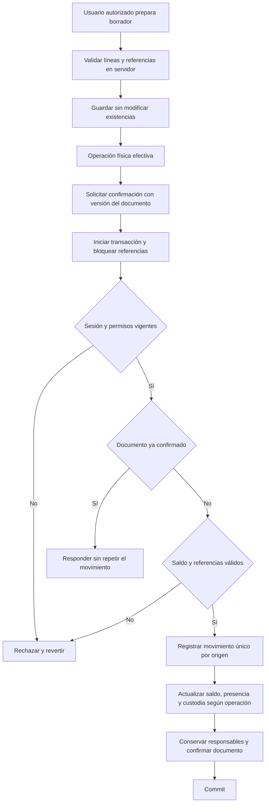
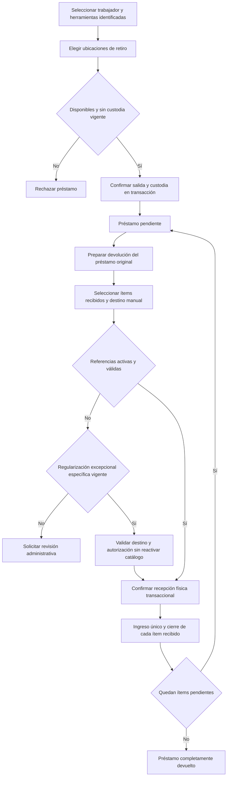
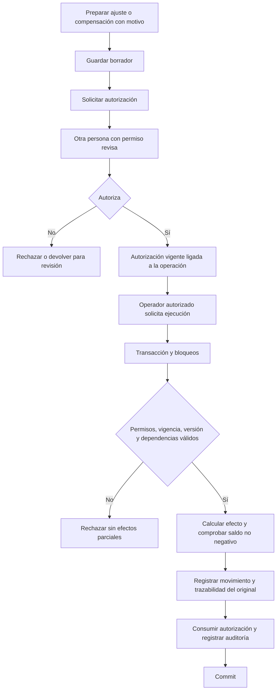
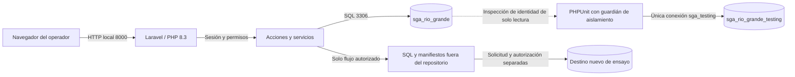

# Diagramas de procesos y despliegue

Versión documental del 5 de noviembre de 2026, basada en las acciones y servicios implementados. Son diagramas lógicos simplificados, no evidencia de ejecución ni de autorización humana. El [modelo de datos](modelo-datos-espanol.md) complementa estas vistas.

## Confirmación de un documento

Las restricciones SQL complementan la validación del servicio. Las cinco fuentes documentales son alternativas del mismo historial; no crean varios movimientos físicos para la misma operación.

## Préstamo y devolución

Desactivar al trabajador no borra la obligación. La ubicación inicial histórica de la unidad no se reemplaza por una supuesta ubicación actual. La compensación de una devolución puede reabrir un ciclo si sus dependencias lo permiten; ese flujo está protegido por el servicio de correcciones.

## Corrección crítica

No se borra ni reescribe el movimiento confirmado. La solicitud y la autorización, por sí solas, no cambian existencias. Una compensación es total y sin cascadas automáticas según el alcance aprobado.

## Despliegue local y fronteras de datos

Principal y testing están en la misma instancia MariaDB local, separados por esquema y controles de conexión. El diagnóstico de identidad de la principal no autoriza escrituras desde PHPUnit. Un entorno persistente de aceptación debe prepararse por separado y no compartir fixtures con la suite. La restauración principal no es una flecha automática de este diseño.
