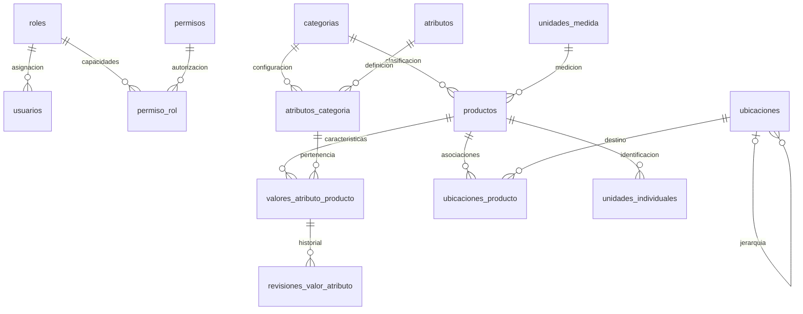
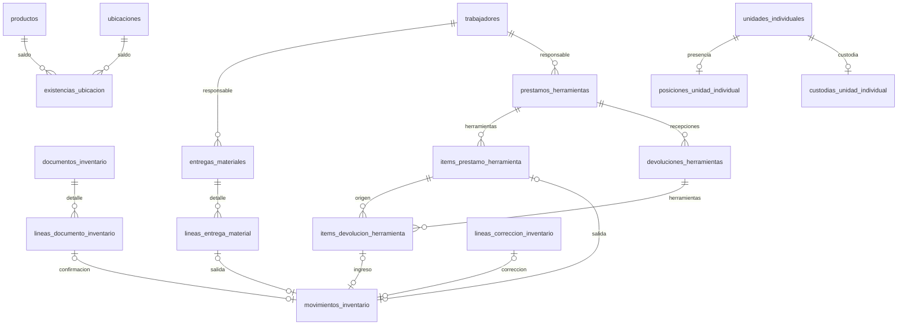
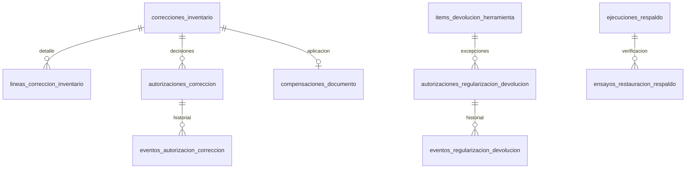

# Modelo de datos en español

Vista simplificada de las entidades de negocio de la rama de traducción. El detalle de las 53 tablas y todas sus columnas figura en el [diccionario](diccionario-datos-espanol.md). No reemplaza los diagramas históricos de los sprints ni acredita aceptación académica externa.

## Acceso y catálogo

`trabajadores` representa al personal del contrato. Un trabajador no necesita una fila en `usuarios`: tener herramientas o materiales asignados es independiente de disponer de acceso al sistema.

## Documentos e inventario

Las cinco relaciones de origen de `movimientos_inventario` son alternativas: el CHECK exige exactamente una fuente por movimiento y los índices únicos impiden repetir el efecto físico de una línea o ítem. El diagrama no representa cinco movimientos para una misma operación. Las asociaciones `ubicaciones_producto` tampoco representan cantidades.

## Control y respaldo

Los ajustes y las compensaciones conservan sus documentos y movimientos. La traducción cambia identificadores del esquema, no las reglas de autorización, las custodias vigentes ni los requisitos de separación de funciones en Backup.
