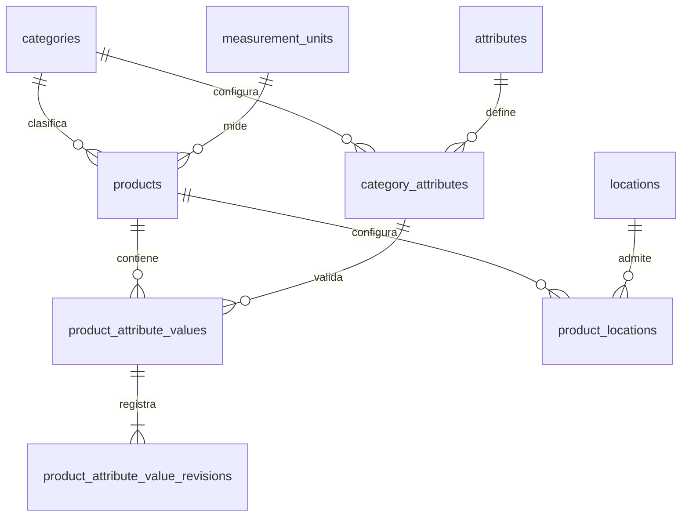

# Sprint 2 — Etapa 4: HU-08, productos

Fecha: 15 de octubre de 2026, America/La_Paz.

Actualización de aplicación principal: 18 de octubre de 2026, America/La_Paz.

Estado: diseño aprobado e implementación verificada en `sprint-2/hu08-productos`, integrada por avance directo en `main` y publicada con autorización. Código y pruebas en `00e007a5be869b07316bad9bd8d44f84befc7a2b`; publicación documentada en `3db8fd6e5e8a4add7ab29de565a87d4d96ff0189`. La suite del 15 de octubre aprobó **280 pruebas y 2.067 verificaciones**, exclusivamente en testing. Las cinco migraciones principales se aplicaron el **18 de octubre**, con autorización expresa y respaldo nuevo verificado, en los lotes **7 a 11**. Hay **25 migraciones aplicadas y ninguna pendiente**. La aplicación principal se comprobó mediante consultas de solo lectura; no se repitieron pruebas automatizadas sobre ella.

## Punto de partida y alcance

Se revisaron AGENTS.md, el plan, diccionario, matriz y los informes de Etapas 1 a 3. `main` estaba limpia y coincidía con GitHub en `88325f05169509df5f886894764408e0c0ff2751`. La conexión principal confirmó `sga_rio_grande`, 19 tablas y 20 migraciones aplicadas. HU-05/HU-06/HU-07/HU-09 estaban implementadas y migradas. La evidencia anterior era de 221 pruebas y 1.602 verificaciones.

El usuario aprobó el diseño de productos, las asociaciones `product_locations`, el historial de revisiones, el código inmutable, el control de edición concurrente y la protección de ubicaciones utilizadas. No se implementan HU-10, existencias, movimientos, remitos, entregas o préstamos. Marcar un producto como prestable únicamente exige modo individual; no crea unidades ni operaciones de préstamo.

## Esquema implementado

Cinco migraciones aditivas del 15 de octubre, posteriores a las 20 existentes:

1. `2026_10_15_000001_create_products_table.php`.
2. `2026_10_15_000002_create_product_attribute_values_table.php`.
3. `2026_10_15_000003_create_product_attribute_value_revisions_table.php`.
4. `2026_10_15_000004_create_product_locations_table.php`.
5. `2026_10_15_000005_add_product_permissions.php`.

La fecha de los nombres corresponde al día de implementación; el diseño se presentó el 14 de octubre. No se modifican migraciones anteriores. Las nuevas rechazan una reversión destructiva mediante `down()`; la recuperación principal necesita un procedimiento autorizado con respaldo.

`products`: código interno único normalizado e inmutable, nombre, descripción, categoría, unidad, marca, referencia, modo `quantity/individual`, prestable, estado, versión de edición, autores y fechas. La unicidad incluye inactivos. CHECK de modo, booleanos, versión positiva y prestable implica individual. Índice de filtros y UNIQUE `(id,category_id)`.

`product_attribute_values`: una fila por producto/configuración, categoría redundante obtenida en el servidor y cuatro columnas tipadas. DECIMAL(18,6), sin FLOAT. CHECK de exactamente un valor y booleanos válidos. Dos FKs compuestas protegen la categoría contra escritura directa:

```text
(product_id,category_id) -> products(id,category_id)
(category_attribute_id,category_id) -> category_attributes(id,category_id)
```

`product_attribute_value_revisions`: instantáneas sucesivas de cada valor y su estado, autor y fecha. UNIQUE `(product_attribute_value_id,revision)`, CHECK de cardinalidad, booleanos y revisión positiva. Se registra la creación inicial y cada cambio efectivo. Vaciar un opcional conserva el último contenido, desactiva la fila y añade revisión; reactivar reutiliza su identificador. Sin rutas de actualización/eliminación de revisiones. El modelo rechaza ambas operaciones; no se afirma que esta protección sustituya controles de acceso SQL del servidor.

`product_locations`: pareja única producto/ubicación con estado, autores y fechas. No tiene cantidades. Una pareja histórica se reactiva y nunca se sustituye o duplica. Las nuevas asociaciones son activas; deben apuntar a producto activo, ubicación activa/almacenable y ancestros activos. Las asociaciones inactivas conservan referencias y bloquean cambios estructurales que reinterpretarían el historial.

Todas las tablas usan InnoDB, utf8mb4 y FKs explícitas con RESTRICT en actualización/eliminación. Los nombres de restricciones son cortos y únicos en la base, compatibles con MariaDB 10.4. Las restricciones entre tablas que requieren consultar configuración o estado se validan en acciones transaccionales, no mediante CHECK con subconsultas.



## Validación y concurrencia

`SaveProduct` y `SaveProductLocation` reutilizan `SecurityMutation`. Adquieren el mutex compartido antes de revalidar al operador y las referencias. Producto, valores, revisiones y ubicaciones iniciales se guardan dentro de una transacción; cualquier fallo revierte el agregado. Los autores son asignados por el servidor.

`lock_version` se compara con la versión actual bajo bloqueo. Un formulario obsoleto obtiene HTTP 409. Se incrementa al cambiar producto, valores o asociaciones; no sustituye las versiones de seguridad de usuarios/roles.

`ProductAttributeValidator` valida pertenencia, definiciones vigentes, obligatoriedad al activar, texto de hasta 255 caracteres, booleano sin confundir falso con ausencia y fecha ISO de calendario válido. Reutiliza `TechnicalDecimal` para rangos y precisión de la unidad técnica del atributo, o seis decimales sin unidad. No acepta floats, exponentes, separadores de miles ni redondea silenciosamente. Los valores históricos de configuraciones inactivas se conservan sin edición.

Categoría, unidad, modo y prestable no se reinterpretan cuando hay valores, asociaciones o futuras unidades referenciadas. El código no puede cambiar incluso sin dependencias. La desactivación conserva filas y no produce movimientos.

Integraciones con historias anteriores:

- Categorías y unidades comprueban productos reales con lecturas actuales bajo bloqueo.
- HU-07 comprueba productos completos al convertir una asociación activa en obligatoria y también al reactivar una asociación ya obligatoria, desde edición y PATCH de estado.
- HU-09 impide desactivar una ubicación con asociaciones activas a productos. Sus protecciones de jerarquía e historial se conservan.
- Rol y permisos se consultan con lectura actual dentro de transacciones, evitando autorizar desde un snapshot anterior a una revocación. Se mantienen el control de sesiones y la protección del último acceso administrativo.

## Duplicados y formularios

El código duplicado se rechaza siempre, también en SQL y frente a inactivos. Para advertencias se prefiltra por categoría/unidad/modo y se comparan todos los identificadores técnicos vigentes e informados. Decimales exactos normalizados, textos sensibles a contenido/mayúsculas/acentos, booleanos y fechas. No hay conversiones, tolerancias implícitas, fusión ni certificación de equivalencia.

Si faltan identificadores o no están configurados se informa que la comparación es insuficiente. Los candidatos inactivos se muestran como tales. La revisión humana permite guardar un producto distinto; el servidor revalida la revisión contra el contenido y candidatos actuales. Un operador sin permiso de lectura recibe una advertencia sin detalles de productos ajenos.

Listado con filtros y paginación, selección de categoría, formulario técnico, revisión previa, ficha con revisiones y gestión independiente de ubicaciones. Blade, CSS existente, mensajes en español y CSRF. No se instala ningún paquete ni se requiere npm. La aceptación visual en navegador sigue pendiente y no se contabiliza como prueba automatizada.

## Permisos

Siete capacidades nuevas: `products.view/create/update/change_status` y `product_locations.view/create/change_status`.

Configuración inicial: Administrador y Encargado reciben siete; Consulta/Auditor recibe las dos de lectura. No se otorgan a roles desconocidos ni se restauran vínculos revocados. La migración conserva personas, asignaciones y permisos previos, aumenta la versión solo si incorpora capacidades y registra el cambio administrativo. Las Policies comprueban permisos, no nombres de roles.

En testing y, desde la aplicación autorizada del 18 de octubre, en la principal, el catálogo inicial tiene 44 permisos y 86 vínculos; capacidades iniciales 44/32/10. La principal pasó de 20 a 25 migraciones aplicadas y las versiones de permisos de sus tres roles pasaron de 4 a 5.

## Trazabilidad y evidencia

| Requisito / historia | Código principal | Prueba |
|---|---|---|
| PRO-01/02/03/04/08 / HU-08 | ProductRequest, ProductController, SaveProduct, Product | ProductManagementTest; ProductIntegrityTest |
| PRO-05; VAL-01/03/05 / HU-08 | ProductAttributeValidator, TechnicalDecimal, FKs compuestas | ProductAttributeValueTest; ProductIntegrityTest |
| PRO-06 / HU-08 | SaveProduct, ProductAttributeHistory | ProductHistoryTest; ProductLocationManagementTest |
| PRO-07 / HU-08 | ProductDuplicateFinder, preview Blade | ProductDuplicateTest |
| VAL-02 / HU-08 | CHECK de valores y revisiones | ProductIntegrityTest |
| VAL-04 e historial / HU-08 | ProductAttributeHistory, modelos de valores/revisiones | ProductHistoryTest |
| PLC-01/02 / HU-08 | SaveProductLocation, ProductLocationController, UNIQUE | ProductLocationManagementTest; ProductIntegrityTest |
| PLC-03 / integración futura HU-10 | ProductReferences | ProductLocationManagementTest, dependencia simulada |
| ASC-03 / HU-07; CAT-03 / HU-05; MED-04 / HU-06 | Guards de referencias reales | ProductHistoryTest |
| LOC-05 / HU-09 | SaveLocation, LocationReferences | ProductLocationManagementTest; ProductConcurrencyTest |
| SEC-01/02/03/04 / HU-08 | Policies, Requests, middleware existente | ProductAuthorizationTest; ProductManagementTest |
| Permisos/sesiones / HU-03 y HU-08 | Migración de permisos, Role, SecurityMutation | ProductPermissionInitializationTest; ProductAuthorizationTest; ProductConcurrencyTest |
| Concurrencia / HU-08 | Acciones, versión, mutex y lecturas actuales | ProductConcurrencyTest, siete escenarios de dos procesos |
| REG-01 | Suite de Sprint 1, HU-05/HU-06/HU-07/HU-09 | Suite completa |

Las siete carreras fuerzan un snapshot previo y espera real del mutex: código repetido, edición obsoleta, ubicación/desactivación en ambos órdenes, obligatoriedad/creación en ambos órdenes y revocación/creación. Cada caso limpia exclusivamente sus identificadores propios en testing; no recrea tablas ni restablece la base.

Resultados realmente ejecutados el 15 de octubre de 2026, sobre PHP 8.3.10, Laravel 13.35.0 y MariaDB 10.4.32:

- Suite completa: **280 pruebas y 2.067 verificaciones**, cero errores/fallos, 3 min 37,660 s. Incluye regresión del Sprint 1, HU-05/HU-06/HU-07/HU-09 y 59 casos nuevos de HU-08.
- Comprobación dirigida previa de productos y carreras anteriores: 62 pruebas y 531 verificaciones aprobadas, antes de añadir tres casos adicionales de formulario/historial.
- Siete carreras nuevas y las seis anteriores aprobadas, con espera real del mutex y conservación de invariantes.
- Pint `--test --dirty`: aprobado. Sintaxis de 63 archivos PHP nuevos/modificados: sin errores.
- Prueba de envío del HTML Blade de revisión, con decimal, falso y fecha: aprobado; incluye escape de contenido y confirmación de candidatos sin fusión.

Durante la validación se corrigieron el orden de limpieza de fixtures con autoría de roles y la medición del mutex en los helpers anteriores. Esta última estaba sobrescribiéndose con las nuevas consultas de permisos con bloqueo. Se repitieron los casos afectados y la suite completa. La limpieza se limitó a identificadores de prueba verificados, sin operaciones de reinicio del esquema.

Evidencia JUnit fuera del repositorio: `C:\Users\jcsem\SGA-backups\hu08-suite-final.xml`. La dependencia real de unidades de PLC-03 y la aceptación UI-01/UI-02 permanecen pendientes de HU-10/aceptación manual.

## Aislamiento y conservación de la principal

Se verificó `SELECT DATABASE()` antes de preparar testing. El bootstrap rechaza configuración cacheada, DB_URL o cualquier destino distinto de `sga_rio_grande_testing`; los procesos hijos verifican también su destino antes de escribir. Los casos ordinarios usan transacciones; no se usa RefreshDatabase ni comandos de borrado/recreación.

Se guardaron huellas de todas las tablas principales y `.env`, fuera del repositorio, en `C:\Users\jcsem\SGA-backups\hu08-baseline-20261015-101229.json`. Este archivo de huellas no es un respaldo SQL ni sustituye el respaldo previo a una futura migración principal.

La comprobación del cierre de implementación del 15 de octubre confirmó contenido idéntico en las 19 tablas principales y `.env` sin cambios. En ese momento, antes de la autorización principal, había 20 migraciones, 37 permisos y 70 vínculos. Testing tenía 25 migraciones, 44 permisos, 86 vínculos y cero usuarios/productos/valores/revisiones/asociaciones remanentes. Informe histórico: `C:\Users\jcsem\SGA-backups\hu08-final-verification.json`. El estado posterior a la aplicación principal se registra a continuación; las 20 migraciones anteriores y los archivos de dependencias se conservaron.

## Aplicación autorizada a la base principal — 18 de octubre de 2026

El usuario autorizó crear el respaldo y aplicar las cinco migraciones después de la prevalidación. Se revalidó `main` limpia y sincronizada en `3db8fd6e5e8a4add7ab29de565a87d4d96ff0189`, PHP 8.3.10, Laravel 13.35.0 y las migraciones anteriores sin modificaciones. MariaDB estaba detenido: se inició el servidor existente de XAMPP con su configuración actual; el servicio independiente MySQL80 permaneció detenido. La conexión Laravel confirmó mediante `SELECT DATABASE()` la base `sga_rio_grande` y MariaDB 10.4.32.

Se abrió mantenimiento y se capturó una referencia nueva de las 19 tablas: filas, conteos, definiciones, huellas y fuentes de las migraciones. No se usó un respaldo de otra etapa como sustituto. Se ejecutó el cliente `C:\xampp\mysql\bin\mysqldump.exe`, distribución MariaDB 10.4.32, con credenciales temporales protegidas fuera del repositorio, retiradas al finalizar. Se utilizaron `--single-transaction`, `--quick`, `--hex-blob`, `--routines`, `--events`, `--triggers`, `--complete-insert`, `--skip-extended-insert`, `--skip-lock-tables`, `--skip-add-locks`, `--skip-add-drop-table` y `--result-file`. Todas las tablas eran InnoDB y no había rutinas, triggers ni eventos.

Respaldo nuevo, fuera del repositorio:

```text
C:\Users\jcsem\SGA-backups\hu08-deployment-20261019-030658-UTC-474b0c32\sga_rio_grande_pre_hu08.sql
```

- Tamaño: **62.311 bytes**; **19 tablas y 145 filas**.
- SHA-256: `121b4626c9fdaa3b8b144c83b648b1d77f03a56ed43a991841eb14633cf0eeb7`.
- Salida de mysqldump correcta y marca de finalización presentes.
- Los 19 nombres y definiciones SQL coincidieron con el estado anterior. Al exportar una fila por INSERT, se comprobó el conteo exacto de filas de cada tabla.
- Las referencias anteriores y posteriores al respaldo coincidieron. No se realizó un ensayo de restauración ni se importó el dump sobre otra base.

El nombre de la carpeta usa UTC: `20261019-030658-UTC` corresponde a la noche del **18 de octubre en America/La_Paz**. El respaldo, manifiestos y registros privados permanecen fuera de Git.

Se aplicaron únicamente estas migraciones, en orden y deteniendo la secuencia ante cualquier error:

| Migración | Lote | Resultado |
|---|---:|---|
| `2026_10_15_000001_create_products_table` | 7 | Aplicada |
| `2026_10_15_000002_create_product_attribute_values_table` | 8 | Aplicada |
| `2026_10_15_000003_create_product_attribute_value_revisions_table` | 9 | Aplicada |
| `2026_10_15_000004_create_product_locations_table` | 10 | Aplicada |
| `2026_10_15_000005_add_product_permissions` | 11 | Aplicada |

Registro del procedimiento limitado ejecutado; no son migraciones pendientes:

```powershell
$hu08Migrations = @(
    'database/migrations/2026_10_15_000001_create_products_table.php',
    'database/migrations/2026_10_15_000002_create_product_attribute_values_table.php',
    'database/migrations/2026_10_15_000003_create_product_attribute_value_revisions_table.php',
    'database/migrations/2026_10_15_000004_create_product_locations_table.php',
    'database/migrations/2026_10_15_000005_add_product_permissions.php'
)
foreach ($hu08Migration in $hu08Migrations) {
    php artisan migrate --path=$hu08Migration --force
    if ($LASTEXITCODE -ne 0) { throw "Se detuvo la aplicación de HU-08 en $hu08Migration" }
}
php artisan migrate:status
```

Comprobaciones posteriores realmente ejecutadas, mediante consultas de solo lectura:

| Elemento | Antes | Después |
|---|---:|---:|
| Tablas | 19 | 23 |
| Migraciones aplicadas | 20 | 25 |
| Permisos | 37 | 44 |
| Vínculos rol–permiso | 70 | 86 |
| Auditorías administrativas | 12 | 15 |
| Roles | 3 | 3 |
| Versión de permisos de cada rol | 4 | 5 |
| Capacidades Administrador / Encargado / Consulta | 37 / 25 / 8 | 44 / 32 / 10 |
| Usuarios / trabajadores | 0 / 0 | 0 / 0 |

Se verificaron las **14 FKs con RESTRICT, 10 CHECK, cinco UNIQUE adicionales a las PK**, índices y tipos; las cuatro estructuras nuevas coinciden con las probadas en testing, ignorando únicamente el contador AUTO_INCREMENT. Se comprobaron las dos FKs compuestas de pertenencia a categoría y ambas columnas DECIMAL(18,6). No se detectaron referencias huérfanas. Las cuatro tablas nuevas quedaron vacías, sin datos de prueba.

Se conservaron las estructuras de las 19 tablas anteriores y las filas existentes. Los únicos cambios previstos fueron cinco registros de migración, siete permisos, dieciséis vínculos, tres auditorías y las versiones/fechas de los roles. No se restauraron revocaciones ni se asignaron privilegios a cuentas desconocidas. `.env`, las fuentes de migraciones y las dependencias quedaron intactas. No hubo seeders generales, comandos destructivos o desarrollo de HU-10. El mantenimiento se cerró después de verificar el resultado.

Evidencia externa en la carpeta del respaldo: `before.json`, `after-backup.json`, `backup-verified.json`, `after-migrations.json`, `deployment-result.json`, `final-readonly-verification.json`, huella `.sql.sha256` y registros individuales de las cinco migraciones. No se incorporan a Git archivos SQL, credenciales ni manifiestos con filas de la base.

Ante un futuro fallo parcial de DDL se debe detener la secuencia, conservar mantenimiento, respaldo y evidencia, y revisar tablas/restricciones/registro antes de proponer una reparación aditiva autorizada. Los `down()` rechazan una reversión destructiva; no se borran tablas ni se restaura encima de la principal automáticamente.

## Archivos

Inventario de archivos nuevos y modificados respecto de `88325f051695`; los informes y las huellas locales de base de datos permanecen fuera del repositorio.

81 archivos:

```text
README.md
app/Actions/Catalog/SaveCategoryAttribute.php
app/Actions/Catalog/SaveLocation.php
app/Actions/Catalog/SaveProduct.php
app/Actions/Catalog/SaveProductLocation.php
app/Http/Controllers/Catalog/ProductController.php
app/Http/Controllers/Catalog/ProductLocationController.php
app/Http/Requests/Catalog/ProductCategoryRequest.php
app/Http/Requests/Catalog/ProductLocationRequest.php
app/Http/Requests/Catalog/ProductLocationSearchRequest.php
app/Http/Requests/Catalog/ProductLocationStatusRequest.php
app/Http/Requests/Catalog/ProductRequest.php
app/Http/Requests/Catalog/ProductSearchRequest.php
app/Http/Requests/Catalog/ProductStatusRequest.php
app/Models/Category.php
app/Models/CategoryAttribute.php
app/Models/Location.php
app/Models/MeasurementUnit.php
app/Models/Product.php
app/Models/ProductAttributeValue.php
app/Models/ProductAttributeValueRevision.php
app/Models/ProductLocation.php
app/Models/Role.php
app/Policies/ProductLocationPolicy.php
app/Policies/ProductPolicy.php
app/Providers/AppServiceProvider.php
app/Services/AttributeReferences.php
app/Services/CatalogReferences.php
app/Services/LocationReferences.php
app/Services/ProductAttributeHistory.php
app/Services/ProductAttributeValidator.php
app/Services/ProductDuplicateFinder.php
app/Services/ProductReferences.php
app/Services/SecurityMutation.php
app/Support/PermissionCatalog.php
database/factories/ProductAttributeValueFactory.php
database/factories/ProductFactory.php
database/factories/ProductLocationFactory.php
database/migrations/2026_10_15_000001_create_products_table.php
database/migrations/2026_10_15_000002_create_product_attribute_values_table.php
database/migrations/2026_10_15_000003_create_product_attribute_value_revisions_table.php
database/migrations/2026_10_15_000004_create_product_locations_table.php
database/migrations/2026_10_15_000005_add_product_permissions.php
docs/data-dictionary-sprint-2.md
docs/global-plan.md
docs/sprint-2-stage-4.md
docs/sprint-2-test-matrix.md
docs/sprint-2.md
resources/views/catalog/product-locations/form.blade.php
resources/views/catalog/product-locations/index.blade.php
resources/views/catalog/products/_attributes.blade.php
resources/views/catalog/products/_values-history.blade.php
resources/views/catalog/products/form.blade.php
resources/views/catalog/products/index.blade.php
resources/views/catalog/products/preview.blade.php
resources/views/catalog/products/show.blade.php
resources/views/dashboard.blade.php
resources/views/errors/409.blade.php
resources/views/layouts/app.blade.php
resources/views/roles/form.blade.php
routes/catalog.php
tests/Feature/Catalog/AttributePermissionInitializationTest.php
tests/Feature/Catalog/CatalogIntegrityTest.php
tests/Feature/Catalog/CatalogPermissionInitializationTest.php
tests/Feature/Catalog/LocationIntegrityTest.php
tests/Feature/Catalog/LocationPermissionInitializationTest.php
tests/Feature/Catalog/ProductAttributeValueTest.php
tests/Feature/Catalog/ProductAuthorizationTest.php
tests/Feature/Catalog/ProductConcurrencyTest.php
tests/Feature/Catalog/ProductDuplicateTest.php
tests/Feature/Catalog/ProductHistoryTest.php
tests/Feature/Catalog/ProductIntegrityTest.php
tests/Feature/Catalog/ProductLocationManagementTest.php
tests/Feature/Catalog/ProductManagementTest.php
tests/Feature/Catalog/ProductPermissionInitializationTest.php
tests/Feature/Catalog/TechnicalAttributeIntegrityTest.php
tests/Feature/RbacSchemaTest.php
tests/Support/CreatesProductCatalog.php
tests/Support/concurrent-administration.php
tests/Support/concurrent-location.php
tests/Support/concurrent-product.php
```
